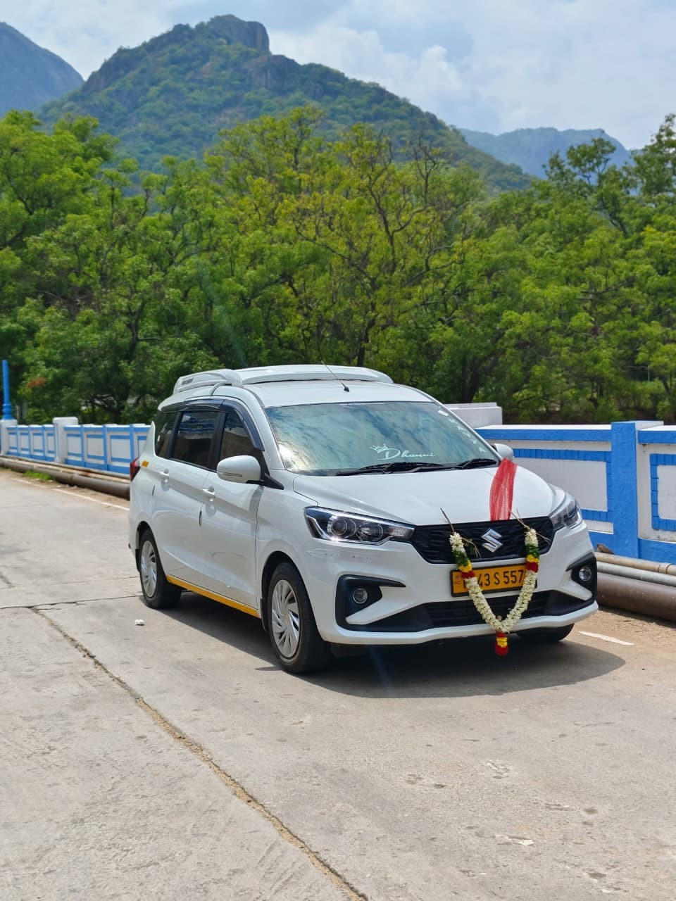
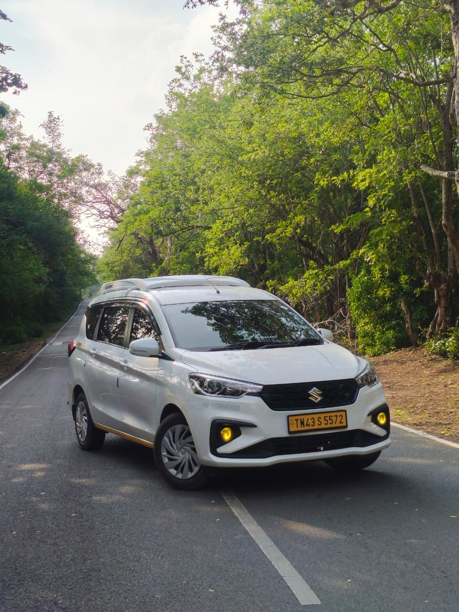
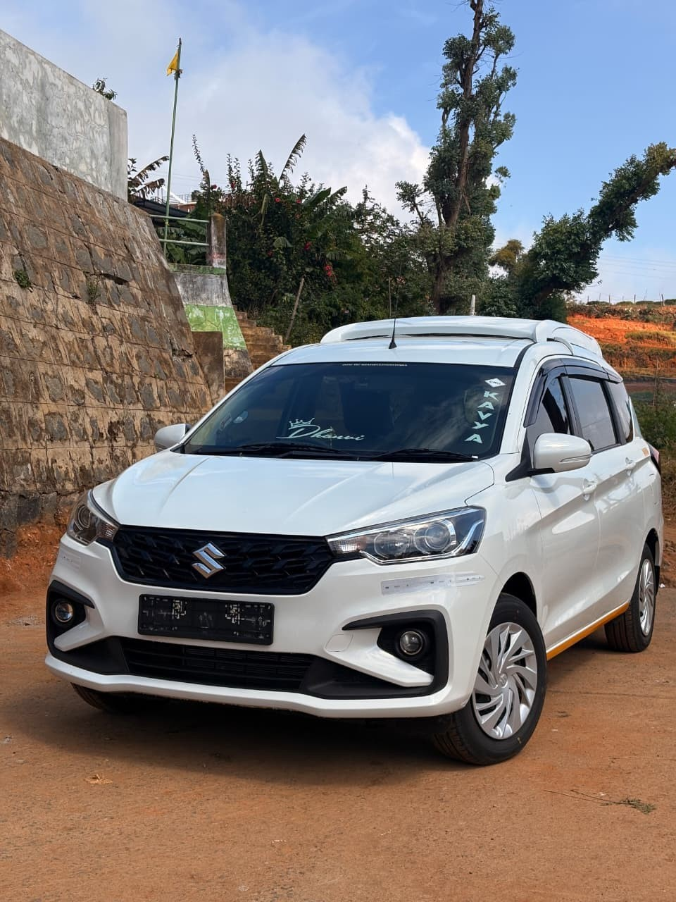
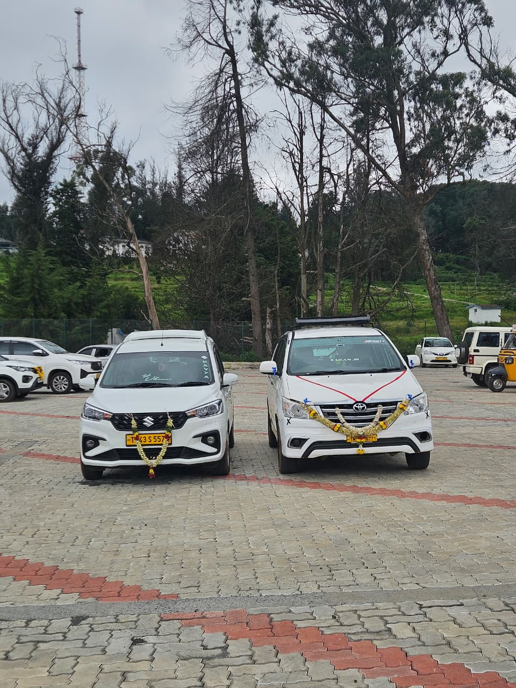
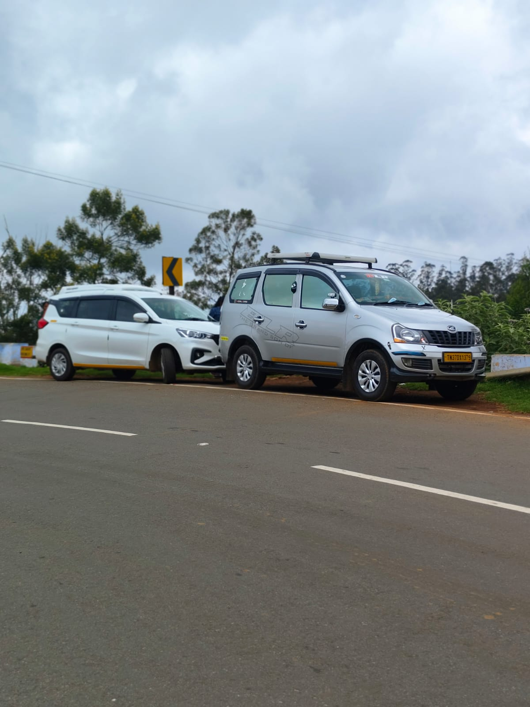

<!DOCTYPE html>
<html lang="en">
<head>
<meta charset="utf-8">
<meta name="viewport" content="width=device-width, initial-scale=1">
<title>Shadow Travel Hub | Car Travels in Ooty, Coimbatore &amp; Tamil Nadu</title>
<meta name="description" content="Reliable car travels: outstation trips, airport pickups, sightseeing tours and one-way drops. Book on WhatsApp.">

</head>
<body>

<header>
  

    
Shadow Travel Hub

    <nav>
      <a href="#services">Services</a>
      <a href="#routes">Routes</a>
      <a href="#gallery">Gallery</a>
      <a href="#booking">Book</a>
      <a href="#reviews">Reviews</a>
      <a href="#contact">Contact</a>
    </nav>
  

</header>

  

    <h1>Comfortable car travel, on time, every time.</h1>
    
Outstation trips, airport pickups and sightseeing tours with polite, experienced drivers and clean cars.

    

      <a class="btn wa" href="https://wa.me/91XXXXXXXXXX?text=Hi%20Shadow%20Travel%20Hub%2C%20I%20want%20to%20book%20a%20car." target="_blank" rel="noopener">Book on WhatsApp</a>
      <a class="btn call" href="tel:+91XXXXXXXXXX">Call now</a>
    

  

<main>
  <section id="services">
    

      <h2>Our services</h2>
      
Pick the trip that fits you. We handle the rest.

      

        
<h3>Outstation trips</h3>
One-way and round-trip rides across Tamil Nadu, Kerala and Karnataka.

        
<h3>Airport pickup &amp; drop</h3>
We track your flight and wait for you at arrivals.

        
<h3>Sightseeing tours</h3>
Ooty, Coonoor, Kodaikanal and more, at a relaxed pace.

        
<h3>Family &amp; group travel</h3>
Sedans, SUVs and tempo travellers for the whole group.

      

    

  </section>

  <section id="routes" style="padding-top:0">
    

      <h2>Popular routes</h2>
      
Don't see yours? Message us and we'll quote it.

      

        Ooty to Coimbatore
        Ooty to Chennai
        Coimbatore Airport
        Ooty to Bangalore
        Ooty to Kochi
        Kodaikanal
      

    

  </section>

  <section id="gallery" style="padding-top:0">
    

      <h2>Photo gallery</h2>
      
Our cars and the places we take you.

      

        <figure><figcaption>Our fleet</figcaption></figure>
        <figure><figcaption>Comfortable cars</figcaption></figure>
        <figure><figcaption>Clean and well kept</figcaption></figure>
        <figure><figcaption>Ready for your trip</figcaption></figure>
        <figure><figcaption>Family travel</figcaption></figure>
      

    

  </section>

  <section id="booking" style="padding-top:0">
    

      <h2>Book your ride</h2>
      
Fill in the details. Your booking request opens in WhatsApp.

      <form id="bookForm">
        <label>Your name<input name="name" required autocomplete="name"></label>
        <label>Phone number<input name="phone" type="tel" required autocomplete="tel"></label>
        <label>Pickup location<input name="pickup" required></label>
        <label>Drop location<input name="drop" required></label>
        <label>Travel date<input name="date" type="date" required></label>
        <label>Pickup time<input name="time" type="time" required></label>
        <label>Trip type
          <select name="trip">
            <option>One way</option>
            <option>Round trip</option>
            <option>Airport pickup/drop</option>
            <option>Sightseeing tour</option>
          </select>
        </label>
        <label>Vehicle
          <select name="vehicle">
            <option>Sedan (4 seats)</option>
            <option>SUV (6-7 seats)</option>
            <option>Tempo traveller (12+ seats)</option>
          </select>
        </label>
        <label>Passengers<input name="pax" type="number" min="1" max="30" value="2"></label>
        <label class="full">Extra notes<textarea name="notes" rows="3" placeholder="Luggage, stops, special requests"></textarea></label>
        <button class="btn wa full" type="submit">Send booking on WhatsApp</button>
        

      </form>
    

  </section>

  <section id="reviews" style="padding-top:0">
    

      <h2>Customer reviews</h2>
      
What our travellers say.

      <!-- REPLACE these samples with real customer reviews -->
      

        

★★★★★

Smooth Ooty to Coimbatore drop. Driver was on time and very polite.
<small>— Customer Name, Coimbatore</small>

        

★★★★★

Great sightseeing tour. Covered all the main spots without any rush.
<small>— Customer Name, Chennai</small>

        

★★★★☆

Airport pickup was hassle-free and the car was clean.
<small>— Customer Name, City</small>

      

    

  </section>

  <section id="contact" class="contact">
    

      <h2>Ready to travel?</h2>
      
Tell us your pickup, drop and date. We reply fast.

      

        <a class="btn wa" href="https://wa.me/91XXXXXXXXXX?text=Hi%20Shadow%20Travel%20Hub%2C%20I%20want%20to%20book%20a%20car." target="_blank" rel="noopener">WhatsApp us</a>
        <a class="btn call" href="tel:+91XXXXXXXXXX">Call us</a>
      

    

  </section>
</main>

<footer>© 2026 Shadow Travel Hub. All rights reserved.</footer>

<a class="float" href="https://wa.me/91XXXXXXXXXX" target="_blank" rel="noopener" aria-label="Chat on WhatsApp">💬</a>

</body>
</html>
